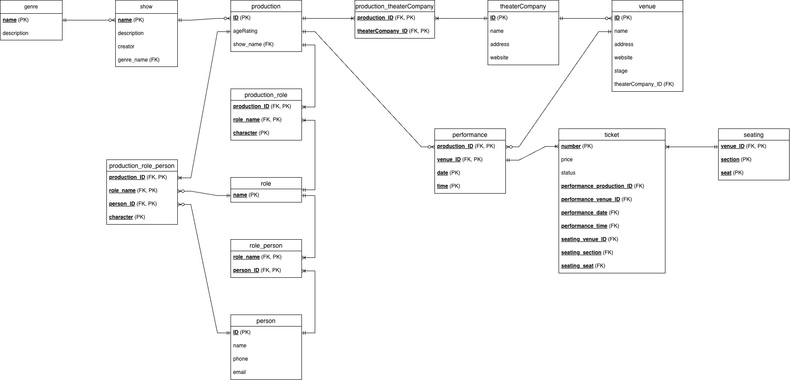

# Twin Cities Performing Arts Database

*A relational database design project for a fictional performance-listing system.*

**Team:** Tu Tran, Yosephine Manihuruk, and Natalia Morales Flores  
**Course:** Introduction to Database Management Systems, Macalester College (2026)  
**Tools:** MariaDB, SQL, ER modeling

We designed a database around a practical question: how could someone find performances across Twin Cities venues, look up an artist's past productions, or trace the people who worked on a show?

The idea was to bring together information that is usually spread across individual theaters: productions, performances, artists, companies, venues, seating, and tickets. This repository preserves the team project's diagrams, SQL implementation, and five query exercises. It is a **database prototype**, not a functioning booking site or a live calendar.

## The model



We distinguished a **show** (the underlying work) from a **production** (a staging of that show) and a **performance** (a specific venue, date, and time). That distinction lets an artist be associated with multiple productions and lets a production have multiple performances.

Other relationships connect people to production roles, theater companies to venues, performances to seats and tickets, and shows to genres. We iterated from a conceptual entity–relationship diagram to a crow's-foot relational model.

[View the conceptual ERD](diagrams/conceptual-erd.jpg) · [View the query diagrams](diagrams/query-precedence-charts.jpg)

## Example questions

The five submitted exercises ask:

1. What performances take place in a specified week?
2. Which productions or shows has an artist worked on?
3. Which past shows have appeared at a particular venue?
4. Which actors worked on a specified production/performance?
5. Which shows belong to a selected genre?

[`sql/Queries.sql`](sql/Queries.sql) preserves the team's original step-by-step implementation, including intermediate tables used to demonstrate filtering, matching, and reduction. [`sql/queries_readonly.sql`](sql/queries_readonly.sql) offers shorter, **read-only equivalents** of the same five questions for browsing the project without creating extra tables.

## Repository files

| Path | Contents |
| --- | --- |
| `sql/Team09Project.sql` | Original MariaDB database dump, including demonstration records and query-result tables |
| `sql/Queries.sql` | Original submitted queries |
| `sql/queries_readonly.sql` | Read-only versions of the five example queries (prepared for this repository) |
| `diagrams/conceptual-erd.jpg` | Conceptual entity–relationship diagram |
| `diagrams/crow-foot-diagram.jpg` | Relational schema / crow's-foot diagram |
| `diagrams/query-precedence-charts.jpg` | Query operation diagrams |
| `docs/team-report.pdf` | Original joint project report and documentation |

## Running the SQL locally

The dump was exported from **MariaDB 10.11**. On a local MariaDB installation, create a separate demonstration database, then import the dump:

```bash
mariadb -u root -p -e "CREATE DATABASE twin_cities_performing_arts CHARACTER SET utf8mb4;"
mariadb -u root -p twin_cities_performing_arts < sql/Team09Project.sql
mariadb -u root -p twin_cities_performing_arts < sql/queries_readonly.sql
```

Alternatively, run individual statements from `queries_readonly.sql` in your SQL client. **These scripts have been reviewed statically for the portfolio, but the import and queries have not been rerun against a live MariaDB server in this packaging step.** The dataset illustrates the design and is not a verified source of current performance schedules.

## Design decisions and limitations

The original conceptual model and implemented SQL do not match in every respect. For example, the diagrams considered multiple theater companies per production and multiple genres per show, whereas the submitted `production` and `show_relation` tables each implement a single foreign-key association. The export also retains intermediate query-result tables, and some demonstration theater-company/venue name and URL values appear in the wrong columns. These are limits of the course implementation, not capabilities of a deployed service.

We also discussed the social implications of such a database in our report: visibility for smaller local arts organizations, possible historical preservation uses, consent and privacy for artists' contact details, and copyright questions around performance descriptions. The sample records should not be mistaken for real reservations or current event listings.

## Attribution

This was a **collaborative course project**, not a solo application. Credit for the model, implementation, and submitted report belongs to **Tu Tran, Yosephine Manihuruk, and Natalia Morales Flores**. The read-only query file and this repository documentation were prepared afterward for portfolio presentation; the original submissions are retained unchanged.
